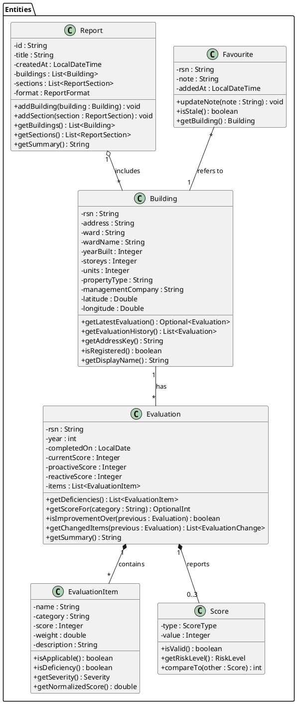
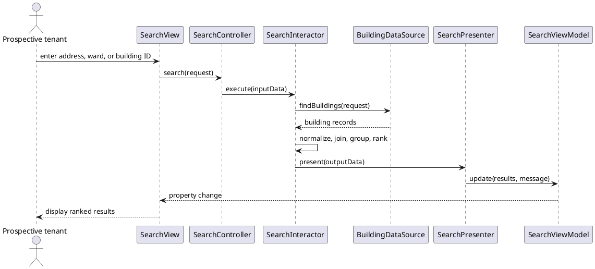
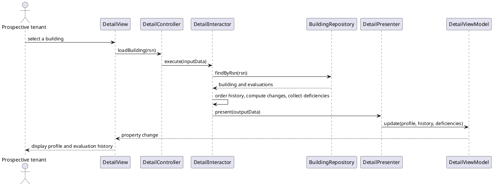
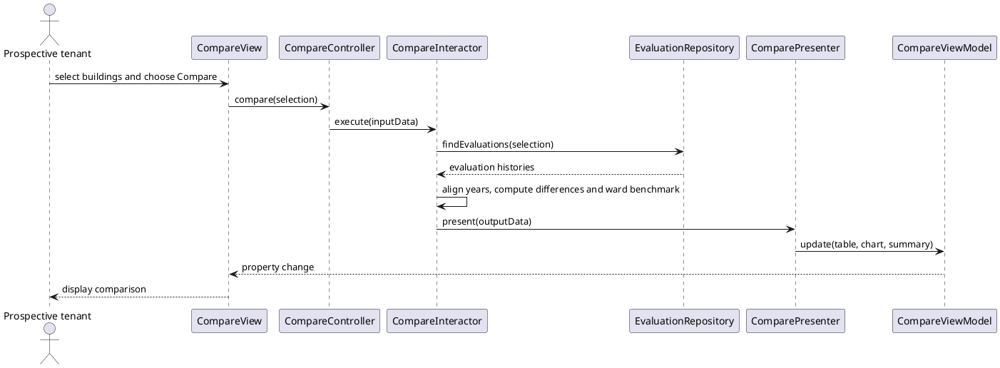
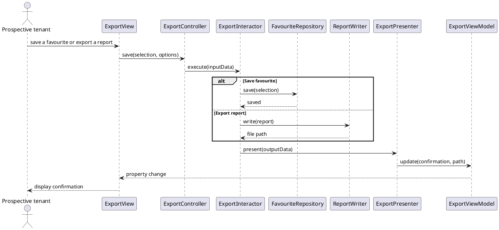

# RentSafeTO Explorer

## Team Information

### Team Members

- Nicholas Cheng
- Belina Zhu
- Sophie Pigott
- Dong He

---

## Project Description

### Domain

Civic technology, housing, and open-data analysis.

### Problem

Prospective renters in Toronto often sign a lease without checking a building's maintenance and evaluation history. The City publishes RentSafeTO evaluation scores, category-level results, and registration details, but the information is split across datasets and is difficult to search, compare, and interpret. Students and first-time renters are especially likely to miss this information.

### What the application does

RentSafeTO Explorer is a desktop application that helps a prospective tenant:

- search for a registered rental building by address, ward, or building ID;
- view the building's evaluation scores, category results, deficiencies, and history;
- compare two buildings or track one building over time;
- save a shortlist and export a report.

The application uses the City of Toronto Open Data API and keeps a local cache so it can still show data when the network is unavailable. It is an independent student project and is not affiliated with the City of Toronto.

### Intended users

Prospective tenants, especially students and first-time renters in Toronto, who want a quick, understandable summary of a building's evaluation history before booking a viewing or signing a lease.

### Glossary

- **RSN:** the City's registration ID for a building. The app calls this the building ID in the user interface.
- **Evaluation:** a City RentSafeTO inspection record with scores and category results.
- **Deficiency:** a category result with a score of 0 or 1.
- **Ward:** the City ward used as the geographic filter. The current dataset does not include neighbourhood names.

---

## User Stories

### User Story 1 - Search for a building

**Owner:** Dong He

As a prospective tenant, I want to search for a rental building by address, ward, or building ID so that I can check its evaluation history before booking a viewing.

### User Story 2 - View evaluation history

**Owner:** Nicholas Cheng

As a prospective tenant, I want to view a building's evaluation scores, deficiencies, and score history so that I can understand its condition and enforcement record.

### User Story 3 - Compare buildings

**Owner:** Belina Zhu

As a prospective tenant, I want to compare two buildings or track one building over time so that I can choose between options and see whether conditions are improving.

### User Story 4 - Save and export

**Owner:** Sophie Pigott

As a prospective tenant, I want to save buildings to a shortlist and export a report so that I can revisit my options and share them with roommates.

---

## Use Cases

### Use Case 1: Search for a Rental Building

**Derived from:** User Story 1

**Primary actor:** Prospective tenant

**Supporting actor:** City of Toronto Open Data service (when live data is used)

**Preconditions:**

- The application is running.
- Building data is available from the live service or a local cache.

**Trigger:** The tenant enters a search term, selects optional filters, and asks to search.

**Success outcome:** A ranked list of matching buildings is displayed, with address, ward, latest evaluation score, and evaluation year.

**Main success scenario:**

1. The tenant enters an address, ward, or building ID and optionally selects filters.
2. The system checks that the search request is valid.
3. The system finds matching buildings from the live service or the local cache.
4. The system combines registration and evaluation information for each building.
5. The system keeps the most recent evaluation for each building.
6. The system ranks the results and displays them.

**Extensions:**

- **2a. The search request is empty or invalid.**
  1. The system explains what is needed and does not search.
- **3a. The live service is unavailable.**
  1. The system uses cached data.
  2. The system tells the tenant that the results may be out of date.
- **3b. No buildings match.**
  1. The system says so and suggests removing filters or broadening the search.
- **4a. Some registration or evaluation records are missing.**
  1. The system still shows the building and marks the missing information.

**Postconditions:** The results are displayed. The search may be added to the tenant's recent searches.

---

### Use Case 2: View Building Evaluation History

**Derived from:** User Story 2

**Primary actor:** Prospective tenant

**Preconditions:**

- The tenant has selected a building from the search results or favourites.

**Trigger:** The tenant opens the building's detail view.

**Success outcome:** The building's profile, latest scores, evaluation history, category results, deficiencies, and changes since the previous evaluation are displayed.

**Main success scenario:**

1. The tenant selects a building.
2. The system retrieves the building's registration and evaluation records.
3. The system orders the evaluations from oldest to newest.
4. The system identifies the latest evaluation and any changes since the previous evaluation.
5. The system displays the building profile, score trend, category breakdown, deficiencies, and changes.

**Extensions:**

- **2a. No registration record exists.**
  1. The system shows the evaluation data and marks the registration as missing.
- **2b. No evaluation records exist.**
  1. The system shows the registration data and explains that no evaluations are available.
- **3a. Some scores are not applicable.**
  1. The system shows them as "not applicable" and leaves them out of comparisons.
- **4a. There is only one evaluation.**
  1. The system hides the change comparison.

**Postconditions:** The detail view is displayed. The tenant can add the building to favourites or compare it.

---

### Use Case 3: Compare Buildings and Track Trends

**Derived from:** User Story 3

**Primary actor:** Prospective tenant

**Preconditions:**

- The tenant has selected two buildings, or one building with at least two evaluations.

**Trigger:** The tenant asks to compare the selected buildings or view the building's trend.

**Success outcome:** A side-by-side comparison and a trend chart are displayed, with a ward benchmark for context.

**Main success scenario:**

1. The tenant selects two buildings or one building over time.
2. The system retrieves the evaluation histories for the selection.
3. The system aligns the evaluations by year and calculates differences.
4. The system calculates a ward benchmark for context.
5. The system displays the comparison table, trend chart, benchmark, and summary.

**Extensions:**

- **2a. One building has no evaluation data.**
  1. The system marks it as having insufficient data and compares what is available.
- **3a. The evaluation years do not overlap.**
  1. The system compares the closest available years and labels the mismatch.
- **4a. The ward has too few evaluated buildings.**
  1. The system hides the benchmark and explains why.

**Postconditions:** The comparison is displayed. The tenant can save it or export it.

---

### Use Case 4: Save Favourites and Export a Report

**Derived from:** User Story 4

**Primary actor:** Prospective tenant

**Preconditions:**

- At least one building is selected.

**Trigger:** The tenant asks to save a favourite or export a report.

**Success outcome:** The favourite or report is saved and can be loaded after the application restarts.

**Main success scenario:**

1. The tenant selects one or more buildings.
2. The tenant chooses to save a favourite or export a report.
3. The system checks the selection and report options.
4. The system saves the favourite or writes the report file.
5. The system confirms the result and shows where the report was saved.

**Extensions:**

- **2a. No buildings are selected.**
  1. The system explains that a selection is required and does not save.
- **4a. The file cannot be written.**
  1. The system explains the problem and keeps the selection so the tenant can try again.
- **4b. A report with the same name exists.**
  1. The system asks whether to overwrite it or choose a new name.

**Postconditions:** The favourite or report is available after restart.

---

## MVP

| Team member    | MVP use case                        |
| -------------- | ----------------------------------- |
| Dong He        | Search for a rental building        |
| Nicholas Cheng | View building evaluation history    |
| Belina Zhu     | Compare buildings and track trends  |
| Sophie Pigott  | Save favourites and export a report |

Each member will lead the interactor, controller, presenter, UI trigger, and UI update for their use case, and will coordinate with anyone sharing a view or data source.

### MVP scope

**In scope:**

- Search by address, ward, or building ID.
- Building profile and evaluation history from 2023 onward.
- Category-level results and deficiencies.
- Compare two buildings or track one building over time.
- Ward benchmark.
- Favourites and HTML/CSV report export.
- Live API access with a local cache.

**Out of scope for the MVP:**

- User accounts and multi-user synchronization.
- Neighbourhood boundary search. The current data has ward, not neighbourhood.
- Building-name search. The current data has addresses, not building names.
- Fire inspection and health hazard datasets.
- Map view.
- PDF export.
- Mobile or web version.
- Official risk score. Any custom score is a future extension and is not the City's score.

---

## Entities

### Building

**Instance variables:**

- `rsn: String` - City registration ID for the building.
- `address: String` - Street address from the City dataset.
- `ward: String` - Ward number.
- `wardName: String` - Ward name.
- `yearBuilt: Integer` - Year the building was built.
- `storeys: Integer` - Number of confirmed storeys.
- `units: Integer` - Number of confirmed units.
- `propertyType: String` - Private, TCHC, or other.
- `managementCompany: String` - Property management company, when available.
- `latitude: Double` - Latitude.
- `longitude: Double` - Longitude.

**Methods:**

- `getLatestEvaluation(): Optional<Evaluation>` - returns the most recent evaluation.
- `getEvaluationHistory(): List<Evaluation>` - returns evaluations ordered by year.
- `getAddressKey(): String` - returns a normalized address key for matching.
- `isRegistered(): boolean` - whether registration data is available.
- `getDisplayName(): String` - returns the address and ward for display.

### Evaluation

**Instance variables:**

- `rsn: String` - Building registration ID.
- `year: int` - Evaluation year.
- `completedOn: LocalDate` - Date the evaluation was completed.
- `currentScore: Integer` - Current building evaluation score.
- `proactiveScore: Integer` - Proactive evaluation score.
- `reactiveScore: Integer` - Reactive score from orders and notices.
- `items: List<EvaluationItem>` - Category-level results.

**Methods:**

- `getDeficiencies(): List<EvaluationItem>` - returns items with a low score.
- `getScoreFor(category: String): OptionalInt` - returns the score for a category.
- `isImprovementOver(previous: Evaluation): boolean` - compares two evaluations.
- `getChangedItems(previous: Evaluation): List<EvaluationChange>` - returns improvements and declines.
- `getSummary(): String` - returns a short human-readable summary.

### EvaluationItem

**Instance variables:**

- `name: String` - Category name, such as "Pest control log".
- `category: String` - Grouping, such as "Health and safety".
- `score: Integer` - 0 to 3, or null when not applicable.
- `weight: double` - Weight of the category, when available.
- `description: String` - City-provided description of the category.

**Methods:**

- `isApplicable(): boolean` - whether the item has a score.
- `isDeficiency(): boolean` - whether the score is 0 or 1.
- `getSeverity(): Severity` - LOW, MEDIUM, or HIGH.
- `getNormalizedScore(): double` - score normalized for comparison.

### Score

**Instance variables:**

- `type: ScoreType` - CURRENT, PROACTIVE, or REACTIVE.
- `value: Integer` - Score value.

**Methods:**

- `isValid(): boolean` - whether the score is present.
- `getRiskLevel(): RiskLevel` - LOW, MEDIUM, or HIGH.
- `compareTo(other: Score): int` - compares two scores.

### Favourite

**Instance variables:**

- `rsn: String` - Building registration ID.
- `note: String` - Tenant's note about the building.
- `addedAt: LocalDateTime` - When the building was saved.

**Methods:**

- `updateNote(note: String): void` - replaces the note.
- `isStale(): boolean` - whether the saved evaluation is older than the latest available.
- `getBuilding(): Building` - returns the associated building.

### Report

**Instance variables:**

- `id: String` - Report identifier.
- `title: String` - Report title.
- `createdAt: LocalDateTime` - Creation time.
- `buildings: List<Building>` - Buildings included in the report.
- `sections: List<ReportSection>` - Report sections.
- `format: ReportFormat` - HTML or CSV.

**Methods:**

- `addBuilding(building: Building): void` - adds a building.
- `addSection(section: ReportSection): void` - adds a section.
- `getBuildings(): List<Building>` - returns the included buildings.
- `getSections(): List<ReportSection>` - returns the included sections.
- `getSummary(): String` - returns a short summary.

**Relationships:**

- A `Building` has zero or more `Evaluation` objects.
- An `Evaluation` has one or more `EvaluationItem` objects and up to three `Score` objects.
- A `Favourite` refers to one `Building`.
- A `Report` includes one or more `Building` objects.

---

## API Usage

**API name:** City of Toronto Open Data CKAN API

**Documentation:**

- CKAN API guide: https://docs.ckan.org/en/latest/api/
- Dataset metadata: https://ckan0.cf.opendata.inter.prod-toronto.ca/api/3/action/package_show?id=apartment-building-evaluation
- Evaluation dataset page: https://open.toronto.ca/dataset/apartment-building-evaluation/
- Registration dataset page: https://open.toronto.ca/dataset/apartment-building-registration/

**Datasets and resources:**

- Apartment Building Evaluation, 2023-current: resource `244f7a02-da5c-425b-b55f-fbdd133dd732`, 7,158 records, refreshed 2026-11-19.
- Apartment Building Registration: resource `3ad76a8c-0518-4df2-b94e-8c747d62f8c1`, 3,611 records, refreshed 2026-07-05.

**How the API is used:**

- `package_search` and `package_show` discover the datasets, resource IDs, and refresh dates.
- `datastore_search` supports live search by address, ward, or building ID, with filters, sorting, pagination, and a total count. It also returns field metadata, including descriptions for the evaluation categories.
- `datastore/dump` refreshes the local cache when the app needs the full dataset.
- The app caches JSON/CSV responses locally so the demo and normal use work offline.
- The app reads CKAN field metadata to display human-readable descriptions for the evaluation categories.
- The app handles network failures, empty results, malformed records, and missing fields.

**Successful call:** Yes. Verified on 2026-11-19.

Example request:

```
GET https://ckan0.cf.opendata.inter.prod-toronto.ca/api/3/action/datastore_search?resource_id=244f7a02-da5c-425b-b55f-fbdd133dd732&q=BALLIOL&limit=2
```

Observed result:

- `success: true`
- `total: 20`
- Records include `RSN`, `SITE ADDRESS`, `YEAR EVALUATED`, `CURRENT BUILDING EVAL SCORE`, and the evaluation category fields.

Example registration request:

```
GET https://ckan0.cf.opendata.inter.prod-toronto.ca/api/3/action/datastore_search?resource_id=3ad76a8c-0518-4df2-b94e-8c747d62f8c1&limit=3
```

Observed result:

- `success: true`
- `total: 3611`
- Records include `RSN`, `SITE_ADDRESS`, `PROP_MANAGEMENT_COMPANY_NAME`, and building amenity fields.

**Notes:**

- `datastore_search_sql` is not available on this CKAN instance. It returns 404, so aggregation and joining are done locally after retrieval.
- The public web page may render the dataset as "Retired," but the CKAN API reports `is_retired: false`, `state: active`, and `last_refreshed: 2026-11-19`. The API metadata is the source of truth for this project.
- The API is keyless. The app should still cache responses and avoid unnecessary repeated requests.

---

## Design Diagrams

### Architecture Overview

The application follows Clean Architecture:

- **Entities:** `Building`, `Evaluation`, `EvaluationItem`, `Score`, `Favourite`, `Report`.
- **Use Cases:** search, view detail, compare, save/export, with input/output data and interactors.
- **Interface Adapters:** controllers, presenters, and view models.
- **Frameworks and Drivers:** Swing views, the CKAN API adapter, and the local JSON/CSV cache.

Dependencies point inward. Controllers depend on input boundaries, interactors depend on data-access interfaces, and adapters implement those interfaces.

```plantuml
@startuml
package "Frameworks and Drivers" {
  [Swing Views]
  [CKAN API Adapter]
  [Local Cache]
  [HTML Report Writer]
  [CSV Report Writer]
}

package "Interface Adapters" {
  [Controllers]
  [Presenters]
  [View Models]
}

package "Use Cases" {
  interface SearchInputBoundary
  interface DetailInputBoundary
  interface CompareInputBoundary
  interface ExportInputBoundary
  interface BuildingDataSource
  interface BuildingRepository
  interface EvaluationRepository
  interface FavouriteRepository
  interface ReportWriter
  [Search Interactor]
  [Detail Interactor]
  [Compare Interactor]
  [Export Interactor]
}

package "Entities" {
  [Building]
  [Evaluation]
  [EvaluationItem]
  [Report]
}

[Swing Views] --> [Controllers]
[Controllers] --> [SearchInputBoundary]
[Controllers] --> [DetailInputBoundary]
[Controllers] --> [CompareInputBoundary]
[Controllers] --> [ExportInputBoundary]
[Search Interactor] ..|> [SearchInputBoundary]
[Detail Interactor] ..|> [DetailInputBoundary]
[Compare Interactor] ..|> [CompareInputBoundary]
[Export Interactor] ..|> [ExportInputBoundary]
[Search Interactor] ..> [BuildingDataSource]
[Detail Interactor] ..> [BuildingRepository]
[Compare Interactor] ..> [EvaluationRepository]
[Export Interactor] ..> [FavouriteRepository]
[Export Interactor] ..> [ReportWriter]
[CKAN API Adapter] ..|> [BuildingDataSource]
[Local Cache] ..|> [BuildingDataSource]
[Local Cache] ..|> [BuildingRepository]
[Local Cache] ..|> [EvaluationRepository]
[Local Cache] ..|> [FavouriteRepository]
[HTML Report Writer] ..|> [ReportWriter]
[CSV Report Writer] ..|> [ReportWriter]
[Search Interactor] --> [Building]
[Detail Interactor] --> [Evaluation]
[Compare Interactor] --> [Evaluation]
[Export Interactor] --> [Report]
[Presenters] --> [View Models]
[View Models] --> [Swing Views]
@enduml
```



### Design Patterns

- **Adapter:** `CkanApiClient` implements `BuildingDataSource` and hides HTTP, JSON, and CKAN details from the use cases.
- **Strategy:** `AddressNormalizer` rules, `RankingStrategy`, and `ReportWriter` allow new behavior without changing interactors.
- **Builder:** `ReportBuilder` assembles a report from a summary, building sections, charts, and provenance.
- **Chain of Responsibility:** address normalization runs through handlers for whitespace, case, street type, direction, and unit removal.
- **Repository:** `BuildingRepository`, `EvaluationRepository`, and `FavouriteRepository` hide local file storage.
- **Observer:** presenters update view models, and views observe those updates.

### Design Principles

- **SRP:** the API adapter, normalizer, record joiner, aggregator, report builder, and writers are separate classes.
- **OCP:** new normalization rules, ranking strategies, and report formats can be added without changing the interactors.
- **DIP:** interactors depend on interfaces such as `BuildingDataSource` and `ReportWriter`, not on HTTP, Swing, or file APIs.
- **ISP:** small interfaces keep each use case dependent only on the operations it needs.

### UML Class Diagram



### Sequence Diagrams

<details>
<summary>Use Case 1: Search for a rental building</summary>



</details>

<details>
<summary>Use Case 2: View building evaluation history</summary>



</details>

<details>
<summary>Use Case 3: Compare buildings and track trends</summary>



</details>

<details>
<summary>Use Case 4: Save favourites and export a report</summary>



</details>

---

## How to Run

The Maven project and runnable JAR will be added during implementation. The intended workflow is:

```bash
mvn clean package
java -jar target/rentsafe-to-explorer.jar
```

The app will use a local cache when one is available. If no cache exists, it will fetch the latest data from the City of Toronto Open Data API.

---

## Notes

### Data source and licence

This project uses open data published by the City of Toronto under the Open Government Licence - Toronto. The app must include attribution to the City of Toronto.

### Data limitations

- Evaluation data is collected and published by the City; it may be incomplete, delayed, or revised.
- The 2023 evaluation process changed the categories and weights, so pre-2023 data is not directly comparable. The MVP uses the 2023-current resource.
- Some category scores are blank, `N/A`, or `0`; the app must handle these explicitly.
- Addresses are inconsistent across records. Matching and normalization are part of the project, not a perfect source of truth.
- A building's evaluation is a point-in-time snapshot. Conditions can change after an evaluation.

### Disclaimer

RentSafeTO Explorer is an independent student project. It is not affiliated with or endorsed by the City of Toronto. It is for information only and is not legal, rental, or safety advice. Renters should verify information with the City and inspect a building before signing a lease.

### Future work

- Neighbourhood boundary search using a separate City neighbourhood dataset.
- Fire inspection and health hazard datasets.
- Map view of buildings and scores.
- Configurable risk score with transparent weights.
- Alerts when a saved building receives a new evaluation.
- PDF report export.
- Optional user accounts and synchronization through the course DB API.
