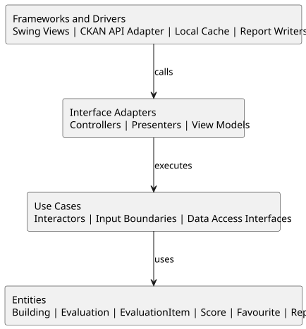
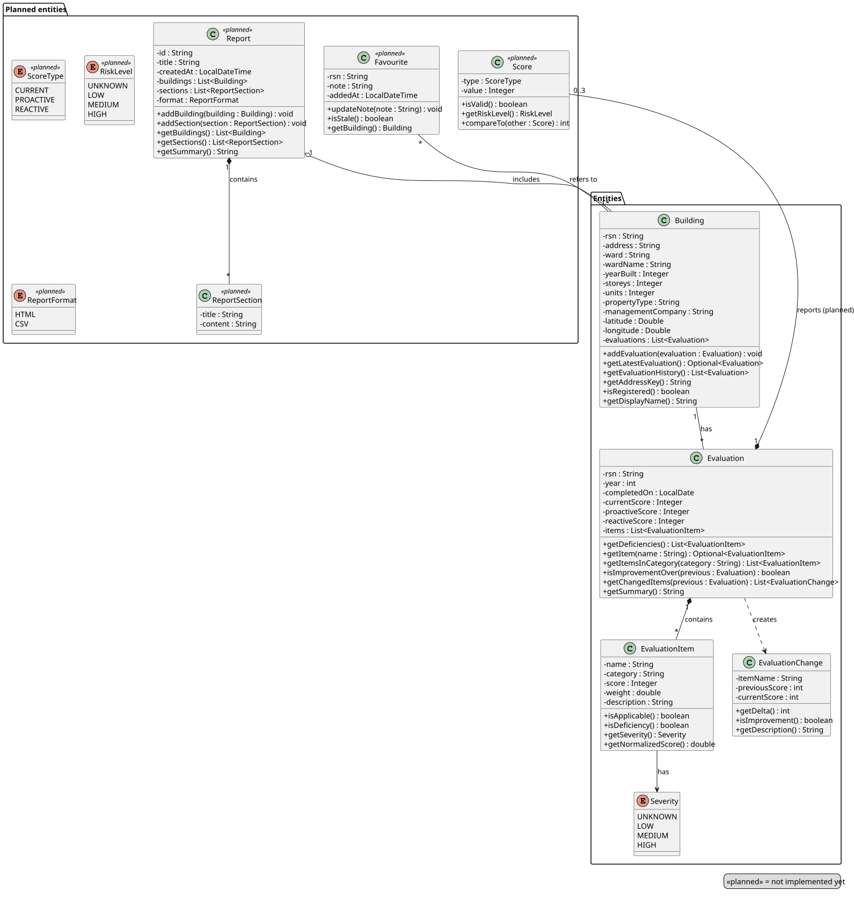
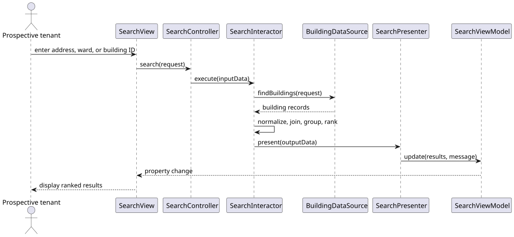
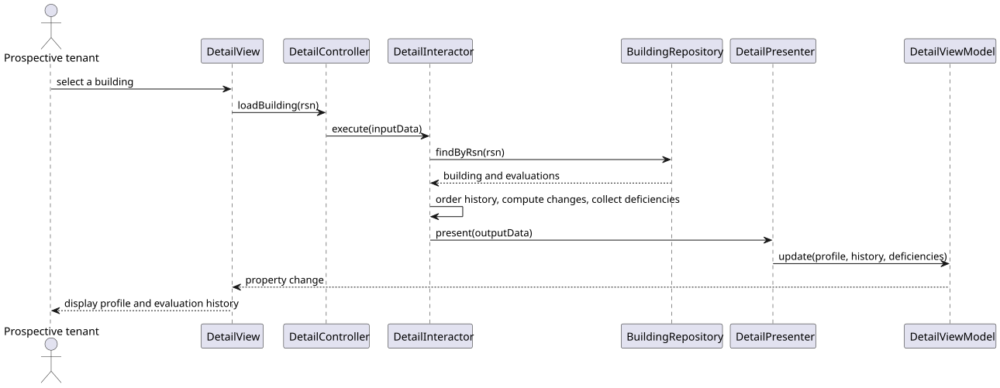
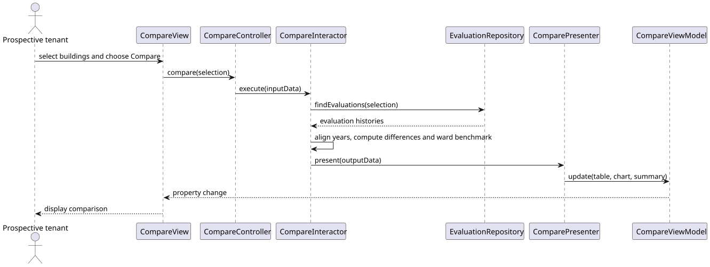
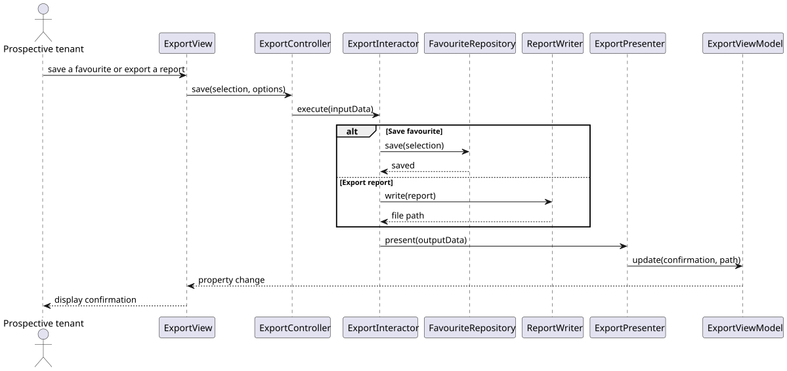

# Design

## Clean Architecture

The application follows Clean Architecture. Dependencies point inward.

| Layer | Package | Responsibility |
| --- | --- | --- |
| Entities | `entity` | Entity classes and enterprise rules. No Swing, data access, or API dependencies. |
| Use Cases | `use_case` | Application rules, input and output boundaries and data, and data access interfaces. |
| Interface Adapters | `interface_adapter` | Controllers, presenters, and view models. |
| Frameworks and Drivers | `view`, `data_access`, `app` | Swing views, CKAN client, local cache, and the composition root. |

Current implementation:

- Entity layer implemented and tested.
- Maven build with Java 11, Checkstyle, JUnit 5, and Surefire.
- Data access and search in progress.
- Detail, compare, and save planned.



## Entity layer

The Entity layer holds the program's model and enterprise rules. It has no dependency on Swing, data access, or the CKAN API.

The implemented entities are:

- `Building`
- `Evaluation`
- `EvaluationItem`
- `EvaluationChange`
- `Severity`

`Score`, `ScoreType`, `RiskLevel`, `Favourite`, and `Report` are planned. The current `Evaluation` stores its three scores as `Integer` fields rather than `Score` objects.

### UML class diagram



The diagram shows the target entity model. The planned entities listed above are drawn with a `<<planned>>` stereotype and are not implemented yet.

## Use case flows

### Search (in progress)



### Detail (planned)



### Compare two buildings (planned)



### Save and export (planned)



The detail, compare, and save diagrams describe the target design. Their interactors, controllers, presenters, and views are not implemented yet.

## Design patterns

Implemented or in progress:

- **Adapter:** `CkanApiClient` implements `BuildingDataSource` and hides HTTP and JSON details from the search use case.
- **Repository:** `CachedBuildingRepository` hides local cache access behind the same interface.
- **Observer:** presenters update view models, and views observe those updates in the search slice.

Planned:

- **Strategy:** address normalization rules, ranking strategies, and report writers.
- **Builder:** report assembly.
- **Chain of Responsibility:** address normalization handlers.

The planned patterns are part of the target design. They should not be described as implemented until the code exists.

## Design principles

- **SRP:** entity rules, the API adapter, the cache repository, and the record mapper have separate responsibilities.
- **DIP:** the search interactor depends on `BuildingDataSource`, not on HTTP or file APIs. Data access implements the interface.
- **ISP:** small interfaces keep each use case dependent only on the operations it needs.
- **OCP:** new normalization rules, ranking strategies, and report formats can be added without changing interactors. This is a design goal for later use cases.

## Diagram sources

The editable PlantUML sources are in `diagrams/`. Regenerate the SVG and PNG images with:

```bash
java -jar plantuml.jar -tsvg docs/diagrams/*.puml
java -jar plantuml.jar -tpng docs/diagrams/*.puml
```
